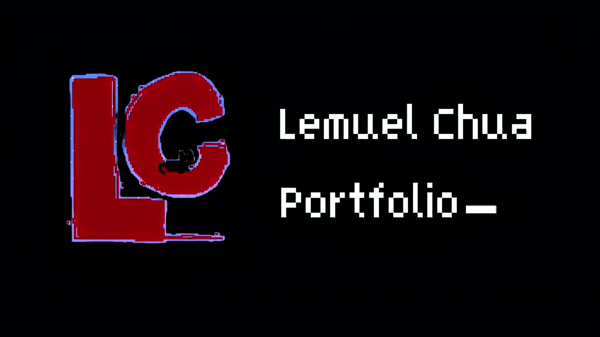
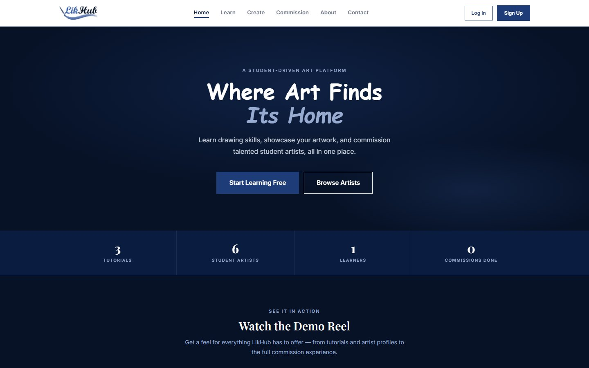
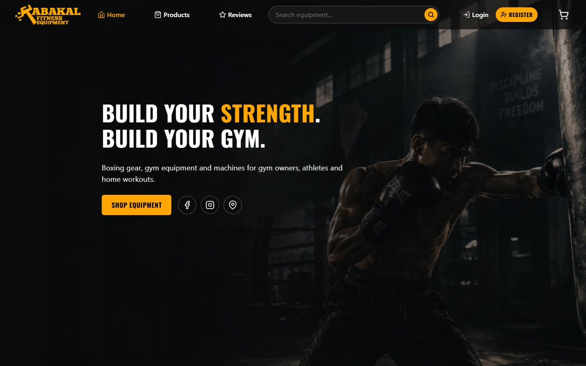

# Lemuel D. Chua — Portfolio



I'm a 3rd-year BS Information Technology student at Pamantasan ng Lungsod ng Valenzuela. This is my personal portfolio: photography, web projects, UI design in Figma, graphic design, networking work and certificates, all in one retro pixel-style site.

It's a **dynamic website built from scratch with PHP and MySQL** (no frameworks), plain HTML/CSS and JavaScript. Everything on the portfolio page is stored in the database and edited from an admin page, so content changes never need code changes.

## Featured projects

| | |
|---|---|
|  | **[LikHub](projects/likhub)** — a platform for student artists: free lessons, a gallery, and commissions between students. I co-founded it and did the development. *PHP, MySQL, JavaScript* |
|  | **[Kabakal](projects/kabakal)** — an online shop and admin system for a fitness equipment store, with GCash payment proof, stock that moves from available to reserved to sold, and a sales dashboard. *PHP (PDO), MySQL, JavaScript* |

The full code for both is in [`projects/`](projects), with steps to run them.

## What the portfolio site does

- Home, About, Portfolio and Contact pages, working on phones (menu button, swipe, no sideways scrolling)
- **Dynamic content** from the `sections`, `items` and `projects` tables, including a case study for each web project (problem, approach, hardest part, result)
- **Manage page** for the admin: upload, edit, hide, reorder and delete items; edit sections and project write-ups; change the admin password
- Photography slideshow, image viewer (arrows, keyboard, swipe), Figma screen carousels, certificate tabs
- Contact form that saves to MySQL, with a spam honeypot and a 30-second flood guard, plus a live admin inbox (new messages pop in without refreshing)
- Security basics: hashed passwords (`password_hash`), CSRF tokens on every form, a lockout after 5 wrong logins, safe file uploads, PHP errors hidden once the site is online, and sign-ups closed on the live site
- Link previews (Open Graph) so shared links show the LC card

## Tech

`PHP 8` · `MySQL / MariaDB` · `PDO` · `JavaScript (fetch / AJAX)` · `HTML` · `CSS` · `XAMPP`

## Run it locally (XAMPP)

1. Copy this folder into `C:\xampp\htdocs\` (for example `C:\xampp\htdocs\Portfolio_Chua`).
2. In the XAMPP Control Panel, start **Apache** and **MySQL**.
3. Open http://localhost/phpmyadmin → **Import** → pick `database.sql` → **Go**. You can import it again later; it never deletes your content.
4. Open http://localhost/Portfolio_Chua
5. Click **LOGIN** and use the local admin account below. Admins get **INBOX** and **MANAGE** in the menu.

### Local admin login

| | |
|---|---|
| Email | `admin@portfolio.local` |
| Password | `LemuelAdmin2026` |

This default account is only for running the site locally. The site warns the admin until the password is changed (**MANAGE → PASSWORD**). **Change it before putting the site online.**

## Settings (`config.php`)

| Setting | What it does |
|---|---|
| `DB_HOST`, `DB_NAME`, `DB_USER`, `DB_PASS` | Database login (XAMPP default is `root` with no password) |
| `DEBUG` | Shows PHP errors. Automatically on in XAMPP and off online |
| `ALLOW_SIGNUP` | Who can use Sign Up. Default: only in XAMPP. Sign-ups are always normal accounts |
| `REQUIRE_LOGIN` | `true` = visitors must log in to see any page |
| `RESUME_FILE` | Path to my resume PDF; a **DOWNLOAD RESUME** button appears when the file exists |
| `GITHUB_REPO` | Link used by the VIEW CODE buttons |

## Folder guide

```
config.php          settings
database.sql        tables (users, messages, sections, items, projects) + starting content
index.php           home
about.php           about me, toolbox, timeline
portfolio.php       all projects
contact.php         contact form (saves to the database)
login.php / register.php / logout.php
admin/              inbox, manage portfolio, edit item / project, change password
includes/           init.php (database, session, helpers), header/footer, content + render helpers, uploads
projects/           code for LikHub and Kabakal (see projects/README.md)
files/              resume PDF goes here
css/  js/           styles and scripts
images/  video/     portfolio media
```

## Contact

- Email: lemuelvhchua@gmail.com
- Instagram: [@shinooooooow](https://www.instagram.com/shinooooooow/)
- Facebook: [LemuelChua05](https://www.facebook.com/LemuelChua05/)
- GitHub: [lemuelvhchua-pixel](https://github.com/lemuelvhchua-pixel)
